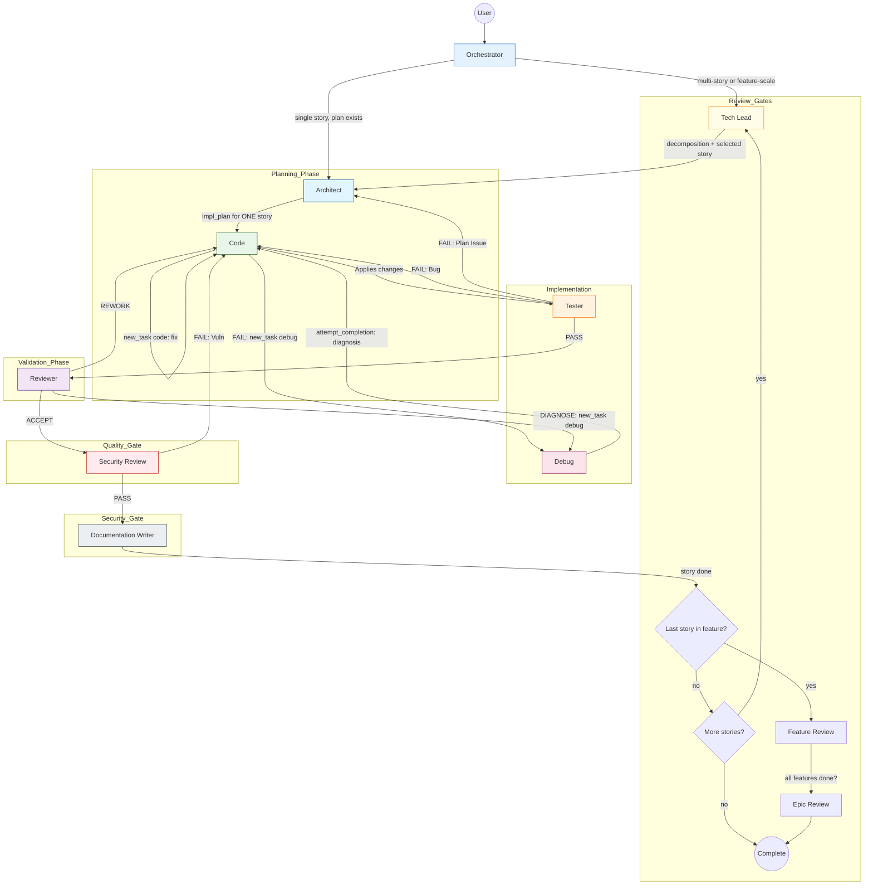

# Zoo Code Custom Modes

This document describes the active workflow for the repository. It intentionally does not define a hidden global section or a pseudo-global routing contract. Each mode owns only its local responsibilities, and the workflow remains centered on the user's selected entry path.

## Workflow policy

- User-selected mode entry is authoritative.
- A single-story request may begin directly in `architect` after a brief story-refinement pass.
- `architect` refines the story before producing the implementation plan.
- `tech-lead` is used only for multi-story, feature-scale, or not-yet-sized requests that require decomposition.
- `debug` is diagnosis-only; it returns a diagnosis to the code parent via `attempt_completion`. The code parent then creates a new code child task for the fix.
- `switch_mode` is not used anywhere in this workflow. All specialist modes call `attempt_completion` when done; the orchestrator parent calls `new_task` for the next specialist. The only exception is Code creating a Debug child via `new_task` for failure diagnosis — after Debug returns, Code continues the fix in its own context.
- Feature review occurs after the final story in a feature.
- Epic review occurs after all feature reviews in an epic.
- Every result packet is written to disk and attached to `attempt_completion`; the packet is not duplicated in chat before or after the file write.

## Orchestrator contract

Orchestrator does not analyze, research, summarize, diagnose, plan, or produce any specialist artifact. Its only valid outputs are:
- A `new_task` call routing to the correct specialist, or
- An `attempt_completion` with a brief one-line completion summary.

Any substantive reasoning, findings, context gathering, or implementation suggestion belongs in a specialist mode. Orchestrator reads only handoff packets and decomposition artifacts that are already present on disk — it does not run searches or produce analysis.

## Session resume after crash

If VS Code is closed mid-session, restart with a new chat and describe which epic/feature/story was active and, if available, the last response. Orchestrator will:
- Route to `architect` (if the story and plan are clear) or `tech-lead` (if scope is unclear) via `new_task`.
- The specialist reads the relevant `.plans/` files to re-establish context and continues from the last written handoff state.

All session state is preserved in the `.plans/` directory. Because every transition produces a written handoff JSON file, no progress is lost — the specialist can determine the last completed step from the most recent handoff file in the story directory.

## Output discipline — file-only artifacts

The following artifacts are **written to file only and must never be echoed to chat**:

| Mode | Artifact | File location |
|------|----------|--------------|
| `tech-lead` | Decomposition XML | `.plans/decomposition.xml` |
| `architect` | Implementation Plan XML | `.plans/EPIC-01-<name>/…/STORY-01-<name>/impl_plan.xml` |

After writing the artifact to file, the mode returns **only a structured completion summary** via `attempt_completion` (or creates the next child task via `new_task`). No XML content, no confirmation message, and no preamble go to chat.

Modes whose primary artifact IS the chat output (because the orchestrator reads it to make routing decisions):

| Mode | Chat artifact |
|------|--------------|
| `tester` | Test Report (structured XML) |
| `reviewer` | Review Report (JSON) |
| `security-review` | Security Audit Report (XML) |
| `code` | Change Log (concise summary) |
| `debug` | Diagnosis Packet (evidence-backed result) |
| `documentation-writer` | Completion summary only |

## Canonical artifact naming

Use a unique ordered hierarchy that preserves the epic, feature, and story identity in readable names.

- Good: `.plans/EPIC-01-user-auth/FEATURE-01-login/STORY-01-email-signin/`
- Good: `.plans/EPIC-01-user-auth/FEATURE-01-login/STORY-01-email-signin/handoff-code-to-tester-20261023T173318Z.json`
- Good: `.plans/archive/EPIC-01-user-auth/FEATURE-01-login/STORY-01-email-signin/`
- Bad: `.plans/handoff-packet.json`
- Bad: `.plans/review-feature-<feature-slug>.json`
- Bad: `.plans/EPIC-01/FEATURE-01/STORY-01/` when the names are not human-readable and do not preserve the unique story meaning
- Bad: timestamps in directory names

Directory names are ordered and human-readable. Timestamps appear only inside filenames when repeated artifacts are required in the same story directory.

## Completion contract

Every mode that exits with a result must:

1. Write the result packet to the unique ordered path for the active story or feature.
2. Attach the same packet to `attempt_completion`.
3. Avoid repeating the packet in chat before or after the file write.

This keeps the system consistent without creating a hidden global layer or cross-mode policy leak.

## Orchestrator persona redirection

When a user prompt includes phrasing like "Act as Tech Lead", "Act as Architect", or "You are the Tech Lead and Architect", Orchestrator must treat that as a **routing instruction** — not a license to perform that mode's work inline. The correct behavior is to create a child task in the named mode (e.g., `tech-lead` first for decomposition, then `architect` for the plan) rather than analyzing or planning within the Orchestrator task itself.

This is enforced by the **Persona redirection rule** in Orchestrator's `# LOCAL POLICY`.

## Prompt Enhancement — custom template

Zoo Code's "Enhance Prompt" feature (wand icon in the chat input) uses a customizable template. The default template is generic and will not prevent "Act as X" phrasing from reaching Orchestrator. A workflow-aware template lives at [`globalZoo/prompts/enhance.md`](../globalZoo/prompts/enhance.md).

**To activate it**, paste the contents of `globalZoo/prompts/enhance.md` into:  
Settings → Prompts → ENHANCE (dropdown) → edit the template field → Save.

This template is global — it lives in `globalZoo/prompts/` alongside the rules and skills. Copy `globalZoo/` to `~/.roo/` and Zoo Code will load it automatically as the global enhance template for all projects.

The template:
- Rewrites "Act as X" / "You are X" into explicit routing directives with the correct mode slug
- Adds `Entry mode: <actual-slug>` so Orchestrator routes to the specialist rather than acting inline
- Scopes multi-mode requests to one mode per prompt, noting the next mode
- Replaces vague directives ("handle this") with concrete action verbs and a named target
- Preserves all technical detail — never summarizes or drops specifics


A key failure mode is accepting user-stated technical values as verified facts without confirmation. This causes downstream modes to implement wrong values, use invalid configuration keys, or create unnecessary files.

**The three failure classes and their mitigations:**

| Failure | Mitigation |
|---------|-----------|
| Tech Lead accepts a stated timeout/config key without verifying it | Tech Lead step 2b (Validate Requirements) is now mandatory; `requirements-fact-checker` skill must run before sizing |
| Architect uses an invalid config key for an external system | Architect step 2 now includes mandatory schema verification via `codebase_search` + `web_search`; unverified keys are blockers, not guesses |
| Code creates a file not in the implementation plan | Code `# HARD CONSTRAINTS` now prohibits speculative file creation; any unlisted file is a `scope-conflict` blocker |

**What Tech Lead must validate before decomposing:**
- Configuration keys — must be confirmed valid in the target system's schema
- Numeric thresholds (timeouts, limits) — must be verified against documented defaults and existing codebase values
- File paths — must exist in the repository
- Env var names — must match what the system actually reads

**What Architect must verify before planning:**
- Every config key proposed for an external system must appear in that system's documented schema
- Every file listed for creation must trace to a named requirement — not a heuristic or a "seems useful" judgment

## Rule directory structure

```
globalZoo/          ← source for the user's global ~/.roo/ folder; copy to ~/.roo/ to activate
  rules/            ← generic rules loaded for every mode in every project (00–90)
  rules-{slug}/     ← generic mode-scoped rules loaded for their specific mode
  skills/           ← reusable skill playbooks referenced in mode instructions
  prompts/          ← global prompt templates (enhance.md for workflow-aware enhancement)

.roo/               ← workspace (project-specific) rules for this repo only
  mcp.json          ← MCP server configuration for this workspace
  rules-{slug}/     ← project-specific mode rules (phase2-*.md, referencing repo scripts)
```

**Separation principle:** `globalZoo/` contains only generic, reusable content that works in any project. `.roo/rules-{slug}/` contains only project-specific rules that reference this repository's scripts, paths, or tooling. The `.roo/rules/` directory must not exist — workspace-wide generic rules live in `globalZoo/rules/` and are loaded globally once the user copies `globalZoo/` to `~/.roo/`.

## Mode-local responsibilities

- `orchestrator`: coordinates child tasks and returns the current result packet to the parent.
- `architect`: refines one story and writes the implementation plan to file; does not echo the plan to chat.
- `tech-lead`: decomposes multi-story or not-yet-sized work; writes the decomposition XML to file; does not echo it to chat.
- `code`: applies the approved implementation.
- `debug`: diagnoses root cause and returns to `code` for the actual patch.
- `tester`: validates the implementation with evidence.
- `reviewer`: performs feature/epic review gates.
- `security-review`: checks the change for security impact.
- `documentation-writer`: handles required doc updates only.

## Workflow diagram



## Mode definitions

### Core workflow modes

| Slug | Name | Purpose | Key Tools/MCPs | Output Artifact |
| :--- | :--- | :--- | :--- | :--- |
| `orchestrator` | 🔀 Orchestrator | Routes requests to the correct specialist; does not analyze or produce artifacts. | `read` (disk only), governance MCP tools | `new_task` routing call |
| `tech-lead` | 🧭 Tech Lead | Sizes the ask and decomposes it into Epics, Features, and sprint-ready Stories. | `codebase_search`, `search_files`, `sequentialthinking`, `memory`, `searxng-mcp` | `.plans/decomposition.xml` (written to file, not echoed) |
| `architect` | 🏗️ Architect | Refines ONE story and plans it into actionable steps. | `sequentialthinking`, `memory`, `searxng-mcp`, `codebase_search` | `impl_plan.xml` (written to file, not echoed) |
| `code` | 💻 Code | Applies approved changes with surgical precision. | `apply_diff`, `write_to_file`, `command` (validation only), `codebase_search` | Change Log |
| `tester` | 🧪 Tester | Validates implementation against acceptance criteria and plan. | `codebase_search`, `command`, `read_command_output` | Test Report XML |
| `reviewer` | 📋 Reviewer | Evaluates quality, scope adherence, and regression risks. Runs feature and epic review gates. | `codebase_search`, `search_files`, `microsoft-learn` | Review Report JSON |
| `security-review` | 🛡️ Security Review | Audits code for vulnerabilities and security best practices. | `codebase_search`, `search_files`, `microsoft-learn` | Security Audit XML |
| `documentation-writer` | 📝 Docs | Creates/updates technical documentation for completed changes. | `codebase_search`, `write_to_file`, `microsoft-learn` | Updated `.md` files |

### Supporting modes

| Slug | Name | Purpose | Key Tools/MCPs | Output Artifact |
| :--- | :--- | :--- | :--- | :--- |
| `debug` | 🔍 Debug | Diagnoses failures; returns diagnosis to code parent via `attempt_completion`. | `codebase_search`, `search_files`, `command`, `apply_diff` (temp probes only) | Diagnosis Packet |
| `skill-writer` | 🧩 Skill Writer | Creates and maintains Agent Skills packages. | `read`, `command`, `edit` (scoped to `skills-project/`, `globalZoo/skills/`) | SKILL.md + skill package |
| `tool-writer` | 🛠️ Tool Writer | Writes custom tools for Zoo in TypeScript/JavaScript. | `read`, `edit` (scoped to `.roo/tools/`), `command`, `mcp` | Custom tool `.ts` file |
| `planning-prompt` | 🧠 Planning Prompt | Generates system prompt artifacts for architect mode. | `read`, `mcp`, `web_search`, `subagent` | System prompt text |

### Mode access control

| Mode | Groups | Edit Scope |
| :--- | :--- | :--- |
| `orchestrator` | read, command, mcp | No edit — routing only |
| `tech-lead` | read, edit, command, mcp | Writes `.plans/decomposition.xml` only |
| `architect` | read, edit, command, mcp | Full edit access |
| `code` | read, edit, command, mcp | Full edit access |
| `tester` | read, command, mcp | Read-only (no edit) |
| `reviewer` | read, mcp | Read-only (no edit) |
| `security-review` | read, edit, mcp | Full edit access |
| `documentation-writer` | read, edit, mcp | Full edit access |
| `debug` | read, command, edit, mcp | Full edit access (diagnostic probes only) |
| `skill-writer` | read, command, edit | Scoped to `skills-project/` and `globalZoo/skills/` files only |
| `tool-writer` | read, command, mcp, edit | Scoped to `.roo/tools/` files only |
| `planning-prompt` | read, mcp | Read-only (no edit) |

## MCP integration

| MCP Server | Modes | Role |
| :--- | :--- | :--- |
| `sequentialthinking` | `architect`, `tech-lead`, `debug`, `planning-prompt` | Primary reasoning engine for structural planning, dependency resolution, and causal analysis. |
| `memory` | `architect`, `tech-lead`, `debug` | Persists architectural decisions and sizing choices across turns and handoffs. |
| `microsoft-learn` | `reviewer`, `security-review`, `documentation-writer` | Verifies API and framework behavior against official Microsoft documentation. |
| `playwright` | `tester` | Used only when UI changes are detected in `impl_plan.xml`. Validates user flows and visual correctness. |
| `searxng-mcp` | `architect`, `tech-lead`, `debug`, `planning-prompt` | Web search and content synthesis. `web_search` for quick factual lookups; `web_search_and_summarize` for complex multi-source research. Falls back to `curl -sL <url> -o /tmp/<slug>.html` when a specific URL is known or a summary is unavailable. |

### searxng-mcp configuration

| Variable | Default | Purpose |
| :--- | :--- | :--- |
| `SEARXNG_URL` | `http://searxng:8080` | SearXNG internal endpoint |
| `FIRECRAWL_URL` | `http://firecrawl:3002` | Firecrawl internal endpoint |
| `RERANKER_URL` | `http://local-reranker:8010/v1/rerank` | Reranker endpoint |
| `OPENAI_BASE_URL` | *(optional)* | OpenAI-compatible proxy for summarization |
| `SEARCH_LLM_MODEL` | `qwen3:4b` | Model for OpenAI-based features |

**Troubleshooting:** `docker compose ps searxng-mcp` / `docker compose logs searxng-mcp`. See [`docs/searxng-mcp.md`](searxng-mcp.md) for full reference.

## Detailed mode process

### Tech Lead

- **Goal**: Size the ask and decompose it into Epics, Features, and sprint-ready Stories.
- **Process**: Parse request → Validate all stated technical values (timeouts, config keys, env vars) against codebase and docs before decomposing → Gather context → Use `sequentialthinking` for dependency resolution → Apply sizing rubric → Write `.plans/decomposition.xml` (do not echo to chat).
- **Output**: XML decomposition artifact with sizing decision, hierarchy, INVEST-compliant stories, dependency-ordered backlog, and handoff node.
- **Flow**: `attempt_completion` → orchestrator routes to architect.

### Architect

- **Goal**: Refine ONE story and create a structured, actionable Implementation Plan.
- **Process**: Refine story (acceptance criteria, dependencies, non-goals) → Verify all config keys against codebase and official docs → Gather context → Use `sequentialthinking` → Write `impl_plan.xml` to the ordered story path (do not echo to chat).
- **Output**: XML plan written to file with task summary, assumptions, risks/blockers, numbered steps, deployment/rollback, and testing strategy.
- **Flow**: `attempt_completion` → orchestrator routes to code.

### Code

- **Goal**: Apply approved changes with surgical precision.
- **Process**: Parse approved change → Minimally verify context → Apply via `apply_diff` or `write_to_file` → Run validation commands if approved → Produce Change Log.
- **Output**: Concise Change Log (title, files changed, changes applied, rationale, constraints, validation status).
- **Flow**: PASS → `attempt_completion` → orchestrator routes to tester. FAIL → write intermediate handoff → `new_task(debug)` → debug returns diagnosis → code continues fix in same context → `attempt_completion`.

### Tester

- **Goal**: Validate implementation against acceptance criteria.
- **Process**: Read `impl_plan.xml` → Run tests (smoke first, then unit/integration) → Capture outputs, exit codes, environment state → Generate Test Report.
- **Output**: Structured Test Report XML (metadata, summary, test results, failures, assumptions/risks, conclusion).
- **Flow**: `attempt_completion` → orchestrator routes: PASS → security-review; FAIL bug → code; FAIL plan → architect.

### Reviewer

- **Goal**: Evaluate quality, scope adherence, and gate feature/epic completion.
- **Process**: Compare implementation against plan → Check scope drift, regressions, test sufficiency → Determine single next direction. After all stories in a feature pass, run a feature-level review. After all features pass, run an epic-level review.
- **Output**: JSON Review Report (status, summary, findings with evidence, exactly one `next_direction`).
- **Flow**: `attempt_completion` → orchestrator routes: ACCEPT → security-review; REWORK → code; DIAGNOSE → debug.

### Security Review

- **Goal**: Audit for vulnerabilities.
- **Process**: Inspect code for security patterns (auth, crypto, I/O, serialization, file access, config, injection, XSS) → Produce severity-rated findings with CWE identifiers.
- **Output**: XML Security Audit Report (findings, overall risk, `go_ahead`).
- **Flow**: `attempt_completion` → orchestrator routes: PASS → documentation-writer; FAIL → code.

### Documentation Writer

- **Goal**: Update technical documentation.
- **Process**: Infer tone/style from existing docs → Update CHANGELOG, README, API docs as needed.
- **Output**: Updated `.md` files.
- **Flow**: `attempt_completion` → orchestrator returns upward.

### Debug

- **Goal**: Diagnose failures and produce a structured Diagnosis Packet.
- **Process**: Reproduce/inspect failing behavior → Trace to root cause → Verify hypothesis with targeted command/search → Record findings and minimal fix direction.
- **Output**: Diagnosis Packet (status, root cause, files inspected, minimal fix direction, validation, recommended next action).
- **Flow**: Returns diagnosis to code parent via `attempt_completion`. Does **not** create a `new_task` for the fix — the code parent creates that task.

### Skill Writer

- **Goal**: Create and maintain Agent Skills packages.
- **Edit Scope**: Restricted to `skills-project/`, `globalZoo/skills/`, and `globalZoo/skills-[mode]/` directories.
- **Output**: SKILL.md entrypoint + optional `references/`, `scripts/`, `assets/` subdirectories.

### Tool Writer

- **Goal**: Write custom tools for Zoo in TypeScript/JavaScript.
- **Edit Scope**: Restricted to `.roo/tools/` directory only.
- **Output**: TypeScript `.ts` tool file + optional `package.json` updates.

### Planning Prompt

- **Goal**: Generate system prompt artifacts for architect mode.
- **Output**: Deployable system prompt text block.

## All modes summary

| # | Slug | Name | Source | Description |
| - | ---- | ---- | ------ | ----------- |
| 1 | `orchestrator` | 🔀 Orchestrator | local | Route requests to specialist modes; no analysis or artifact production |
| 2 | `tech-lead` | 🧭 Tech Lead | global | Size the ask and decompose into Epics, Features, and sprint-ready Stories |
| 3 | `architect` | 🏗️ Architect | global | Refine one story and write the implementation plan |
| 4 | `code` | 💻 Code | global | Apply approved code changes with surgical precision |
| 5 | `tester` | 🧪 Tester | global | Validate implemented changes against acceptance criteria |
| 6 | `reviewer` | 📋 Reviewer | global | Evaluate completed work for quality and run feature/epic review gates |
| 7 | `security-review` | 🛡️ Security Review | global | Identify security vulnerabilities with severity ratings and remediation guidance |
| 8 | `documentation-writer` | 📝 Documentation Writer | global | Create clear, accurate technical documentation for completed changes |
| 9 | `debug` | 🔍 Debug | global | Diagnose failures and produce structured Diagnosis Packets |
| 10 | `skill-writer` | 🧩 Skill Writer | global | Create and maintain Agent Skills packages |
| 11 | `tool-writer` | 🛠️ Tool Writer | global | Write custom tools for Zoo Code |
| 12 | `planning-prompt` | 🧠 Planning Prompt | global | Generate system prompt artifacts for architect mode |

## Governance model

### Governance boundaries

1. `new_task` and `attempt_completion` are the only mode-transition mechanisms. `switch_mode` is not used.
2. Skills are reusable playbooks and do not create new authority channels.
3. Shared rules are normative across modes; mode-scoped rules tighten behavior further.

### Governance change-control gates

No governance tool should be promoted into default mode flow unless all of the following are true:

1. It solves a workflow gap not already covered by base mode flow.
2. It has unique non-overlapping intent.
3. It has an explicit contract, failure behavior, and evidence model.
4. It does not replace `new_task`/`attempt_completion` or core mode authority.
5. It is documented in current-state docs only after it is actually wired.

### Global governance matrix

| Mode | Global Rules | Global Skills | Transition |
| :--- | :--- | :--- | :--- |
| `orchestrator` | trust-safety, handoff-contract, blocker-taxonomy | — | `new_task` to first specialist |
| `tech-lead` | trust-safety, handoff-contract, blocker-taxonomy | `epic-feature-story-decomposition`, `requirements-fact-checker`, `global-orchestration-pack-maintainer` | `attempt_completion` → orchestrator routes to architect |
| `architect` | trust-safety, handoff-contract, blocker-taxonomy | `handoff-transition-auditor`, `scope-drift-guard`, `requirements-fact-checker`, `global-orchestration-pack-maintainer`, `mcp-trust-safety-compliance` | `attempt_completion` → orchestrator routes to code |
| `code` | trust-safety, handoff-contract, blocker-taxonomy | `scope-drift-guard` | PASS: `attempt_completion` → orchestrator routes to tester; FAIL: `new_task(debug)` then continue fix then `attempt_completion` |
| `tester` | handoff-contract, blocker-taxonomy, evidence-minimums | `handoff-transition-auditor`, `validation-evidence-curator` | `attempt_completion` → orchestrator routes to security-review, code, or architect |
| `reviewer` | trust-safety, handoff-contract, blocker-taxonomy, evidence-minimums | `handoff-transition-auditor`, `validation-evidence-curator`, `scope-drift-guard`, `global-orchestration-pack-maintainer`, `mcp-trust-safety-compliance` | `attempt_completion` → orchestrator routes to security-review, code, or debug |
| `security-review` | trust-safety, blocker-taxonomy, evidence-minimums | `handoff-transition-auditor`, `validation-evidence-curator`, `mcp-trust-safety-compliance` | `attempt_completion` → orchestrator routes to documentation-writer or code |
| `documentation-writer` | handoff-contract, blocker-taxonomy | `scope-drift-guard`, `global-orchestration-pack-maintainer`, `global-rulepack-curator`, `mcp-trust-safety-compliance` | `attempt_completion` to parent |
| `debug` | blocker-taxonomy, evidence-minimums | `handoff-transition-auditor`, `validation-evidence-curator`, `scope-drift-guard` | `attempt_completion` with diagnosis to code parent |

### Skill and rule application guidance

1. Skills are consulted only when tasks match their scope.
2. Skills do not expand mode authority or override mode boundaries.
3. Global skills remain portable and free of repository runtime assumptions.
4. Repository add-on skills may exist but are outside the reusable global pack contract.
5. Shared rules apply across core modes.
6. Mode-scoped rules tighten role behavior without introducing repository-specific assumptions.
7. Rules are normative constraints, not optional suggestions.
8. Prompt contracts in `docs/custom_modes.yml` must align with shared and mode-scoped rule behavior.

### Tool minimization and anti-duplication

1. No tool is added without unique non-overlapping intent.
2. Governance MCP tools may validate or lint, but must not replace base mode responsibilities.
3. Operator and runtime probes are not baseline AI task tools.
4. Skills, rules, and MCP tools reinforce one another without parallel control paths.

### Explicit exclusions

This workflow intentionally excludes:

1. n8n workflow planning and n8n MCP tooling
2. Repository CI/CD and deployment wiring
3. Repository runtime probes and operator diagnostics
4. Stack-specific runtime governance details

## Shared global rules

Files currently under `globalZoo/rules/`:

| # | File | Purpose |
| - | ---- | ------- |
| 1 | `00-trust-safety.md` | Consent, side effects, tool risk labels, least-privilege posture |
| 2 | `10-handoff-contract.md` | Canonical handoff packet shape and contract rules |
| 3 | `20-blocker-taxonomy.md` | Allowed blocker tags and classification guidance |
| 4 | `30-evidence-minimums.md` | Required evidence in tester, reviewer, security-review, and debug outputs |
| 5 | `40-tool-minimization.md` | Tool surface rules, web search fallback, direct-fetch guidance |
| 6 | `50-transition-authority.md` | `new_task`/`attempt_completion` authority chain; `switch_mode` not used |
| 7 | `60-scope-control.md` | Keep each mode inside its declared authority |
| 8 | `70-validation-order.md` | Validate narrowest relevant thing first |
| 9 | `80-output-discipline.md` | Deterministic, artifact-only outputs; no conversational filler |
| 10 | `90-context-minimization.md` | Read and reason over only the context needed for the current step |

Mode-scoped global rules live under `globalZoo/rules-{slug}/`.  
Current code-mode rules: `10-approved-change-only.md`, `20-post-edit-validation.md`, `30-diff-safety.md`.  
Project-specific mode rules live under `.roo/rules-{slug}/` (e.g., `phase2-*.md` referencing repo scripts).

## Implemented skills

### Global skills (`globalZoo/skills/`)

| Skill | Purpose |
| :--- | :--- |
| `create-docker-tiered-configuration` | Manage environment variables for Docker Compose projects with multiple services and deployment targets. Provides a structured workflow for separating service-specific env files, target-specific overrides, and Docker Compose variables. Used by the LLM Router project's `profiles/` directory structure. |
| `epic-feature-story-decomposition` | Decompose user requests into Agile hierarchy (Epic/Feature/Story) with INVEST-compliant stories and Given-When-Then acceptance criteria. Includes sizing rubric, story-splitting guide, and XML output schema. |
| `global-orchestration-pack-maintainer` | Maintain the reusable global orchestration pack (modes, rules, governance contracts) while keeping repository-specific behavior out of global definitions. |
| `global-rulepack-curator` | Maintain the separated global rules hierarchy; prevent duplication between `globalZoo/rules/` and `.roo/rules/`. |
| `handoff-transition-auditor` | Validate handoff payload quality, transition basis clarity, and authoritative next-mode routing across the workflow. |
| `mcp-trust-safety-compliance` | Enforce MCP trust/safety controls: consent before side effects, least privilege, transparent tool intent, audit-ready evidence. |
| `requirements-fact-checker` | Validate stated technical values (timeouts, config keys, env vars, file paths) against codebase evidence and official documentation before accepting them as requirements. Mandatory in Tech Lead (step 2b) and Architect (step 2) when the request contains specific technical values. |
| `scope-drift-guard` | Detect hidden task expansion, role bleed, and mode-scope violations. |
| `validation-evidence-curator` | Enforce strong, reproducible evidence capture in tester, reviewer, security-review, and debug artifacts. |

### Repository add-on skills (`skills-project/`)

| Skill | Purpose |
| :--- | :--- |
| `librechat-runtime-governance` | LibreChat-specific runtime governance checks |
| `llmrouter-run-tests` | LLM router test execution helpers |
| `n8n-approval-automation` | n8n approval flow automation |
| `retrieval-quality-ops` | Retrieval quality operations |
| `router-policy-operations` | Router policy operations |

Repository add-on skills are project-specific and not part of the reusable global pack.

## Repository tooling

The following scripts exist in this repository but are not part of the baseline AI task-tool surface:

| Script | Purpose |
| :--- | :--- |
| `scripts/phase2-tooling-checks.sh` | Structural and parity checks for the generated repository |
| `scripts/phase2-ops-tooling.sh` | Operator diagnostics (logs, endpoint checks, secret scans) |
| `scripts/phase2-process-tooling.sh` | Runtime probes and wrapper utilities |

These are project-specific implementation details, not generic AI task tools, and not substitutes for core mode flow.
